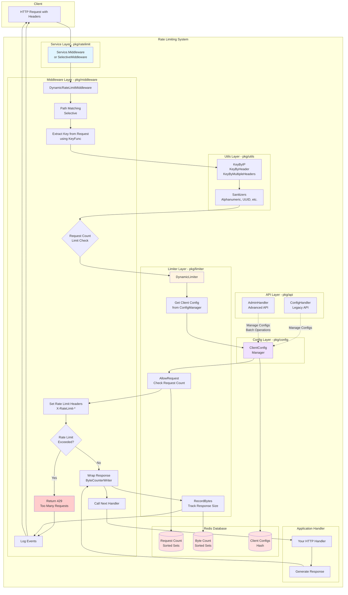

# go-ratelimit - Redis-based Rate Limiting for Go

[](https://gitlab-master.nvidia.com/kratos-dataverse-observability/go-ratelimit/pipelines)

NVIDIA® go-ratelimit is a comprehensive, Redis-based rate limiting library for Go HTTP services. It provides high-performance, distributed rate limiting with support for both request count and bandwidth (bytes served) limits, making it ideal for protecting APIs and managing resource consumption in cloud-native applications.

> **Note**: This project is being prepared for open source release. The import paths will change from `gitlab-master.nvidia.com/kratos-dataverse-observability/go-ratelimit` to `github.com/NVIDIA/go-ratelimit` once the project is officially released on GitHub.

For the latest stable version ensure you are on the `main` branch.

## Features

- **Dual Rate Limiting**: Limits both request count and response size (bytes served)
- **Sliding Window Algorithm**: More accurate than fixed windows, prevents traffic spikes at window boundaries
- **Redis-Based**: Works across multiple server instances in a distributed environment
- **Resilient Fallback**: Maintains rate limits in memory if Redis becomes unavailable
- **Dynamic Per-Client Configuration**: Customize rate limits for each client at runtime
- **RFC Compliant Headers**: Returns standard rate limit headers for client awareness
- **Customizable Key Generation**: Limit by client ID, IP address, route, or any combination
- **Header-Based Rate Limiting**: Rate limit by any HTTP header (API key, tenant ID, custom fields, etc.)
- **Advanced Header Options**: Sanitizers, prefixes, fallbacks, and composite keys from multiple headers

## Installation

### As a Library

```bash
go get gitlab-master.nvidia.com/kratos-dataverse-observability/go-ratelimit/pkg/ratelimit
```

### As a Standalone Server

```bash
# Using Docker
docker run -p 8080:8080 -p 8081:8081 -p 8082:8082 \
  -e RATELIMIT_REDIS_ADDR=redis:6379 \
  go-ratelimit:latest

# Using Docker Compose
docker-compose up -d

# Using Kubernetes
kubectl apply -f deployment/kubernetes/
```

## Quick Start

```go
import (
    "gitlab-master.nvidia.com/kratos-dataverse-observability/go-ratelimit/pkg/ratelimit"
    "github.com/redis/go-redis/v9"
)

func main() {
    // Create Redis client
    rdb := redis.NewClient(&redis.Options{
        Addr: "localhost:6379",
    })
    
    // Create rate limiter with default options
    options := ratelimit.DefaultOptions(rdb)
    service := ratelimit.New(options)
    
    // Create your HTTP handler
    mux := http.NewServeMux()
    mux.HandleFunc("/api/resource", handleResource)
    
    // Apply rate limiting middleware
    handler := service.Middleware()(mux)
    
    // Start server
    http.ListenAndServe(":8080", handler)
}
```

## Configuration Options

```go
// Create with custom options
options := ratelimit.Options{
    Redis:        redisClient,
    Prefix:       "myapp",
    RequestLimit: 100,              // 100 requests per window
    ByteLimit:    5 * 1024 * 1024,  // 5MB per window
    Window:       time.Minute,      // 1 minute window
    KeyFunc:      ratelimit.KeyByClientIDAndRoute("client123"),
    Logger:       myCustomLogger,   // Optional: custom logger for rate limit events
}

service := ratelimit.New(options)
```

### Logger Interface

You can provide a custom logger that implements the `middleware.Logger` interface:

```go
type Logger interface {
    Info(msg string, keysAndValues ...interface{})
    Error(msg string, keysAndValues ...interface{})
}
```

If no logger is provided, the service uses a no-op logger by default.

## Key Functions

The library provides several built-in key functions:

```go
// Limit by client ID
ratelimit.KeyByClientID("client123")

// Limit by client ID and route
ratelimit.KeyByClientIDAndRoute("client123")

// Limit by IP address only
ratelimit.KeyByIP

// Limit by HTTP header (NEW)
ratelimit.KeyByHeader("X-API-Key")
ratelimit.KeyByHeader("X-Tenant-ID")
ratelimit.KeyByHeader("X-Custom-Field")

// Advanced header options (NEW)
ratelimit.KeyByHeaderWithOptions(utils.HeaderKeyOptions{
    HeaderName:    "X-Tenant-ID",
    Prefix:        "tenant",
    Sanitizer:     utils.AlphanumericSanitizer,
    DefaultValue:  "default-tenant",
    CaseSensitive: false,
})

// Multiple headers composite key (NEW)
ratelimit.KeyByMultipleHeaders([]string{"X-Tenant-ID", "X-Region"}, ":")

// Header with fallback chain (NEW)
ratelimit.KeyByHeaderWithFallback([]string{"X-API-Key", "Authorization"})

// Custom key function
myKeyFunc := func(r *http.Request) string {
    return "custom:" + r.URL.Path
}
```

### Built-in Sanitizers

The library provides several sanitizer functions for cleaning header values:

```go
// Removes non-alphanumeric characters
utils.AlphanumericSanitizer

// Validates and normalizes UUIDs
utils.UUIDSanitizer

// Truncates strings to a maximum length
utils.MaxLengthSanitizer(100)
```

📖 **[Detailed Header-Based Rate Limiting Guide](docs/HEADER_BASED_RATE_LIMITING.md)**

## Selective Rate Limiting

You can apply rate limiting only to specific endpoints:

```go
// Create a matcher for specific paths
matcher := ratelimit.MatchAny(
    ratelimit.MatchPathExact("/api/expensive"),
    ratelimit.MatchPathPrefix("/api/users/"),
    ratelimit.MatchPathRegex("^/api/.*\\.json$"),
)

// Apply rate limiting only to paths matching the criteria
handler := service.SelectiveMiddleware(matcher)(mux)
```

Available matchers:
- `MatchPathExact(path)` - Matches exact path
- `MatchPathPrefix(prefix)` - Matches paths with a specific prefix
- `MatchPathRegex(pattern)` - Matches paths using a regular expression
- `MatchAny(matchers...)` - Matches if any matcher matches
- `MatchNone(matchers...)` - Matches if no matcher matches

## Service API

The `Service` struct provides the following methods:

```go
// Middleware application
service.Middleware()                        // Apply rate limiting to all requests
service.SelectiveMiddleware(matcher)        // Apply rate limiting to specific paths

// Configuration management
service.SetClientConfig(clientID, reqLimit, byteLimit, windowSecs)  // Set client-specific limits
service.ResetClientConfig(clientID)                                   // Reset to defaults
service.RegisterConfigAPI(mux)                                        // Register config endpoints

// Access internals
service.GetLimiter()                        // Get underlying DynamicLimiter
```

## Dynamic Client Configuration

### Programmatic Configuration

```go
// Set custom limits for a specific client
service.SetClientConfig("premium-client", 
    1000,               // 1000 requests
    10 * 1024 * 1024,   // 10MB
    60)                 // per minute

// Reset client to default configuration
service.ResetClientConfig("client-id")
```

### REST API Configuration

Register the configuration API endpoints:

```go
// Register the configuration API
service.RegisterConfigAPI(mux)
```

This adds the following endpoints:

- `GET /admin/config/{clientID}` - Get client's configuration
- `PUT /admin/config/{clientID}` - Update client's configuration
- `DELETE /admin/config/{clientID}` - Reset client to default configuration

Example API usage:

```bash
# Get a client's configuration
curl -H "X-Admin-Key: my-admin-key" \
     http://localhost:8080/admin/config/client123

# Update a client's configuration
curl -X PUT -H "X-Admin-Key: my-admin-key" \
     -H "Content-Type: application/json" \
     -d '{"request_limit": 200, "byte_limit": 2097152, "window_secs": 60}' \
     http://localhost:8080/admin/config/client123

# Reset a client to default configuration
curl -X DELETE -H "X-Admin-Key: my-admin-key" \
     http://localhost:8080/admin/config/client123
```

## Resilient Rate Limiting

The library provides a resilient rate limiter that automatically falls back to in-memory rate limiting when Redis is unavailable:

```go
// Create a resilient rate limiter
resilientLimiter := limiter.NewResilientLimiter(
    rdb,                // Redis client
    "rl",               // Key prefix
    10,                 // Default request limit
    1048576,            // Default byte limit (1MB)
    time.Minute,        // Window duration
    keyBuilderFunction, // Function to extract key from request
)

// Use it with middleware
handler := middleware.DynamicRateLimitMiddleware(resilientLimiter)(nextHandler)
```

📖 **[Detailed Resilient Rate Limiting Guide](docs/RESILIENT_RATE_LIMITING.md)**

## Architecture

The library consists of several modular components:

```
pkg/
├── ratelimit/
│   └── ratelimit.go              # Main package API and service
├── limiter/
│   ├── redis.go           # Simple request count limiter
│   ├── dual_limiter.go    # Combined request count and byte limiter
│   ├── dynamic_limiter.go # Dynamic per-client configurable limiter
│   ├── memory.go          # In-memory rate limiter implementation
│   └── resilient_limiter.go # Resilient limiter with Redis fallback
├── middleware/
│   ├── ratelimit.go              # HTTP middleware for request count limiting
│   ├── dual_ratelimit.go         # HTTP middleware for dual limiting
│   ├── dynamic_ratelimit.go      # Dynamic middleware with per-client configs
│   ├── selective_ratelimit.go    # Selective path-based rate limiting
│   ├── bytecounter.go            # Response writer wrapper to count bytes
│   └── logger.go                 # Logger interface and no-op implementation
├── config/
│   ├── config.go                 # Configuration structures
│   └── manager.go                # Per-client configuration manager
├── api/
│   ├── config_handler.go         # Legacy config API endpoints
│   └── admin_handler.go          # Advanced admin API with batch operations
├── utils/
│   ├── request.go                # Helper functions for key generation
│   └── header_keys.go            # Header-based key extraction and sanitizers
└── logger/
    └── logger.go                 # Structured logging with Zap/OpenTelemetry
```

### Flow Diagram



**Flow Explanation:**

1. **Request arrives** with headers (API key, tenant ID, etc.)
2. **Service layer** routes to appropriate middleware (all requests or selective)
3. **Middleware** extracts rate limit key using configurable KeyFunc (IP, headers, composite)
4. **Utils layer** applies sanitizers and generates clean rate limit keys
5. **Limiter** checks client-specific config from Redis, then validates request count
6. **Rate limit headers** are set on response (X-RateLimit-Limit, X-RateLimit-Remaining, etc.)
7. **Decision point**: 
   - If limit exceeded → Return 429 with retry information
   - If allowed → Wrap response writer to count bytes
8. **Application handler** processes request and generates response
9. **After response**, byte count is recorded to Redis for bandwidth limiting
10. **Logging** captures all rate limit events
11. **Admin APIs** (shown with dashed lines) allow runtime configuration updates

The system uses Redis sorted sets for sliding window rate limiting and hash storage for per-client configurations.

## Examples

See the [examples](./examples) directory for complete working examples:

- [Basic Example](./cmd/examples/basic/main.go) - Simple rate limiting setup
- [Dynamic Example](./cmd/examples/dynamic/main.go) - Dynamic per-client configuration
- [Resilient Example](./examples/resilient_limiter/main.go) - Resilient rate limiting with Redis fallback

## System Requirements

### Go requirements

* Go >= 1.21

### Redis requirements

* Redis >= 5.0

### OS requirements

* Linux, macOS, and Windows are supported
  * x86_64 (64-bit)
  * aarch64 (64-bit)

## Server Deployment

### Running as a Server

When deploying `go-ratelimit` as a standalone server:

#### Configuration

The server can be configured via:
1. YAML configuration files (see `configs/server.yaml`)
2. Environment variables (with `RATELIMIT_` prefix)
3. Command-line flags

#### Available Endpoints

**gRPC API (port 8080)**
- Rate limit check service

**HTTP/REST Gateway (port 8081)**
- REST API for rate limit checks
- Same functionality as gRPC but over HTTP

**Admin/Metrics API (port 8082)**
- `/health` - Health check endpoint
- `/metrics` - Prometheus metrics
- `/admin/config/{clientID}` - Client configuration management
- `/admin/batch` - Batch configuration operations

#### Docker Deployment

```bash
# Build the image
docker build -t go-ratelimit:latest .

# Run with custom configuration
docker run -d \
  --name ratelimit-server \
  -p 8080:8080 -p 8081:8081 -p 8082:8082 \
  -e RATELIMIT_REDIS_ADDR=redis:6379 \
  -e RATELIMIT_DEFAULT_REQUEST_LIMIT=1000 \
  -e RATELIMIT_DEFAULT_BYTE_LIMIT=10485760 \
  -e RATELIMIT_ADMIN_KEY=your-secret-key \
  -v $(pwd)/configs:/configs \
  go-ratelimit:latest
```

#### Kubernetes Deployment

```bash
# Create namespace
kubectl create namespace ratelimit

# Deploy Redis
kubectl apply -f deployment/kubernetes/redis.yaml

# Deploy rate limit server
kubectl apply -f deployment/kubernetes/deployment.yaml
```

#### Monitoring

The server includes built-in Prometheus metrics and can be monitored using the included Grafana dashboard:

```bash
# Deploy full monitoring stack
docker-compose up -d

# Access services
# - Rate Limit Server: http://localhost:8081
# - Admin API: http://localhost:8082
# - Prometheus: http://localhost:9090
# - Grafana: http://localhost:3000 (admin/admin)
```

## Development

The project includes a Makefile to simplify common development tasks:

```bash
# Build the main binary
make build

# Run tests
make test

# Run tests with coverage
make test-cover

# Format code
make fmt

# Run linter
make lint

# Show all available commands
make help
```

### Running Tests

The project includes comprehensive tests for all components:

```bash
# Run all tests
make test

# Run tests with coverage report
make test-cover
```

Tests cover:
- **Redis-based limiters**: Request count, byte count, and dual limiting
- **Dynamic configuration**: Per-client configuration management
- **Key generation**: IP-based, client ID-based, header-based, and composite keys
- **Header sanitizers**: Alphanumeric, UUID, and max-length sanitizers
- **Path matching**: Selective rate limiting with various matchers
- **Byte counting**: Response size tracking
- **Middleware**: Integration tests for all middleware types
- **Admin API**: Configuration API endpoints
- **Concurrent operations**: Thread-safe operations under load

The test suite includes both unit tests and integration tests with Redis.

## Resources

- [Documentation](docs/) - Additional documentation and guides
- [Examples](examples/) - Working examples for various use cases
- [Setup Guide](SETUP_GUIDE.md) - Detailed setup instructions
- [Header-Based Rate Limiting Guide](docs/HEADER_BASED_RATE_LIMITING.md) - Advanced header-based limiting
- [Resilient Rate Limiting Guide](docs/RESILIENT_RATE_LIMITING.md) - Building resilient systems

## Contributing

Review the [CONTRIBUTING.md](CONTRIBUTING.md) file for information on how to contribute code and issues to the project.

## License

This project is licensed under the Apache License 2.0 - see the [LICENSE](LICENSE) file for details.

Copyright 2025 NVIDIA Corporation