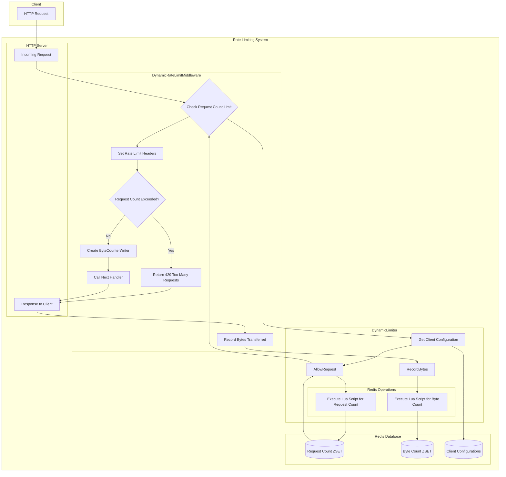

# Go Rate Limiting Library

A comprehensive, Redis-based rate limiting library for Go HTTP services.

## Features

- **Dual Rate Limiting**: Limits both request count and response size (bytes served)
- **Sliding Window Algorithm**: More accurate than fixed windows, prevents traffic spikes at window boundaries
- **Redis-Based**: Works across multiple server instances in a distributed environment
- **Dynamic Per-Client Configuration**: Customize rate limits for each client at runtime
- **RFC Compliant Headers**: Returns standard rate limit headers for client awareness
- **Customizable Key Generation**: Limit by client ID, IP address, route, or any combination

## Installation

```bash
go get github.com/dheerajk/go-ratelimit/pkg/ratelimit
```

## Quick Start

```go
import (
    "github.com/dheerajk/go-ratelimit/pkg/ratelimit"
    "github.com/redis/go-redis/v9"
)

func main() {
    // Create Redis client
    rdb := redis.NewClient(&redis.Options{
        Addr: "localhost:6379",
    })
    
    // Create rate limiter with default options
    options := ratelimit.DefaultOptions(rdb)
    service := ratelimit.New(options)
    
    // Create your HTTP handler
    mux := http.NewServeMux()
    mux.HandleFunc("/api/resource", handleResource)
    
    // Apply rate limiting middleware
    handler := service.Middleware()(mux)
    
    // Start server
    http.ListenAndServe(":8080", handler)
}
```

## Configuration Options

```go
// Create with custom options
options := ratelimit.Options{
    Redis:        redisClient,
    Prefix:       "myapp",
    RequestLimit: 100,              // 100 requests per window
    ByteLimit:    5 * 1024 * 1024,  // 5MB per window
    Window:       time.Minute,      // 1 minute window
    KeyFunc:      ratelimit.KeyByClientIDAndRoute("client123"),
    AdminKey:     "my-admin-key",
}

service := ratelimit.New(options)
```

## Key Functions

The library provides several built-in key functions:

```go
// Limit by client ID
ratelimit.KeyByClientID("client123")

// Limit by client ID and route
ratelimit.KeyByClientIDAndRoute("client123")

// Limit by IP address only
ratelimit.KeyByIP

// Custom key function
myKeyFunc := func(r *http.Request) string {
    return "tenant:" + r.Header.Get("X-Tenant-ID")
}
```

## Selective Rate Limiting

You can apply rate limiting only to specific endpoints:

```go
// Create a matcher for specific paths
matcher := ratelimit.MatchAny(
    ratelimit.MatchPathExact("/api/expensive"),
    ratelimit.MatchPathPrefix("/api/users/"),
    ratelimit.MatchPathRegex("^/api/.*\\.json$"),
)

// Apply rate limiting only to paths matching the criteria
handler := service.SelectiveMiddleware(matcher)(mux)
```

Available matchers:
- `MatchPathExact(path)` - Matches exact path
- `MatchPathPrefix(prefix)` - Matches paths with a specific prefix
- `MatchPathRegex(pattern)` - Matches paths using a regular expression
- `MatchAny(matchers...)` - Matches if any matcher matches
- `MatchNone(matchers...)` - Matches if no matcher matches

## Dynamic Client Configuration

### Programmatic Configuration

```go
// Set custom limits for a specific client
service.SetClientConfig("premium-client", 
    1000,               // 1000 requests
    10 * 1024 * 1024,   // 10MB
    60)                 // per minute

// Reset client to default configuration
service.ResetClientConfig("client-id")
```

### REST API Configuration

Register the configuration API endpoints:

```go
// Register the configuration API
service.RegisterConfigAPI(mux)
```

This adds the following endpoints:

- `GET /admin/config/{clientID}` - Get client's configuration
- `PUT /admin/config/{clientID}` - Update client's configuration
- `DELETE /admin/config/{clientID}` - Reset client to default configuration

Example API usage:

```bash
# Get a client's configuration
curl -H "X-Admin-Key: my-admin-key" \
     http://localhost:8080/admin/config/client123

# Update a client's configuration
curl -X PUT -H "X-Admin-Key: my-admin-key" \
     -H "Content-Type: application/json" \
     -d '{"request_limit": 200, "byte_limit": 2097152, "window_secs": 60}' \
     http://localhost:8080/admin/config/client123

# Reset a client to default configuration
curl -X DELETE -H "X-Admin-Key: my-admin-key" \
     http://localhost:8080/admin/config/client123
```

## Architecture

The library consists of several modular components:

```
pkg/
├── ratelimit/
│   └── ratelimit.go       # Main package API
├── limiter/
│   ├── redis.go           # Simple request count limiter
│   ├── dual_limiter.go    # Combined request count and byte limiter
│   └── dynamic_limiter.go # Dynamic per-client configurable limiter
├── middleware/
│   ├── ratelimit.go       # HTTP middleware for request count limiting
│   ├── dual_ratelimit.go  # HTTP middleware for dual limiting
│   └── bytecounter.go     # Response writer wrapper to count bytes
├── config/
│   └── manager.go         # Per-client configuration manager
├── api/
│   └── config_handler.go  # API endpoints for managing client configs
└── utils/
    └── request.go         # Helper functions for key generation
```

### Flow Diagram



## Examples

See the [cmd/examples](./cmd/examples) directory for complete working examples:

- [Basic Example](./cmd/examples/basic/main.go) - Simple rate limiting setup
- [Dynamic Example](./cmd/examples/dynamic/main.go) - Dynamic per-client configuration

## Requirements

- Go 1.18 or higher
- Redis 5.0 or higher

## Development

The project includes a Makefile to simplify common development tasks:

```bash
# Build the main binary
make build

# Run tests
make test

# Run tests with coverage
make test-cover

# Format code
make fmt

# Run linter
make lint

# Build all examples
make examples

# Run the server example
make run-server

# Run the basic example
make run-basic

# Run the dynamic example
make run-dynamic

# Show all available commands
make help
```

### Running Tests

The project includes comprehensive tests for all components:

```bash
# Run all tests
make test

# Run tests with coverage report
make test-cover
```

Tests cover:
- Key generation and request utilities
- Path matching for selective rate limiting
- Byte counting middleware
- Core rate limiting functionality

## License

Nvidia